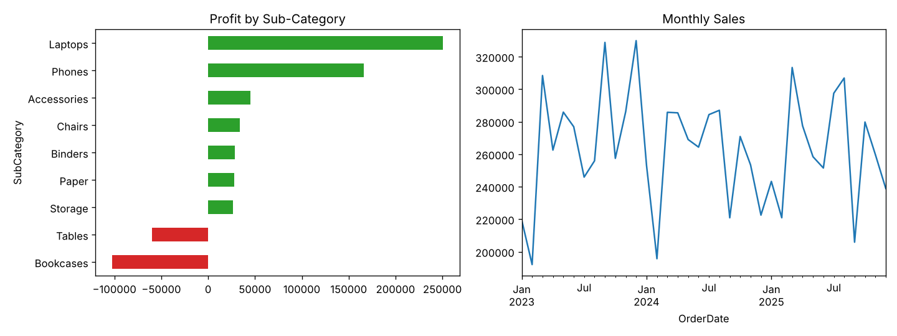

# Sales Performance Dashboard (Power BI)

An interactive Power BI dashboard that turns 10,000 retail sales records into answers about **revenue, profit and trends** across regions and product categories.

> **Data note:** The dataset is *synthetic*, generated by `scripts/generate_data.py` (seeded, so it is reproducible). It mimics a retail "Superstore"-style dataset. You can swap in a real dataset with the same columns.

## Tools
Power BI Desktop, Power Query (M), DAX, Python (pandas) for data generation and cross-checking.

## Repository layout
```
data/sales_data.csv        10,000 orders, 2023-2025
scripts/generate_data.py   builds the dataset
scripts/insights.py        pandas cross-check of dashboard numbers
powerquery/transform.m     cleaning and typing steps (Power Query)
dax/measures.dax           date table + KPI and time-intelligence measures
images/insights_preview.png  preview of key charts
```

## How to build the dashboard (about 1 hour)
1. **Get data:** Power BI Desktop > *Get data* > *Text/CSV* > `data/sales_data.csv` > *Transform data*.
2. **Clean:** In *Advanced Editor* paste `powerquery/transform.m` (fix the file path). It sets data types, removes duplicate OrderIDs, drops null rows and adds Year / Month columns.
3. **Model:** Create the `Date` table and all measures from `dax/measures.dax`. Mark `Date` as a date table and relate `Date[Date]` to `sales_data[OrderDate]`.
4. **Report page 1: Overview**
   - KPI cards: Total Sales, Total Profit, Profit Margin %, Total Orders
   - Line chart: Total Sales by Month (compare with Sales LY)
   - Clustered bar: Total Sales by Region
   - Slicers: Year, Region, Segment, Category
5. **Report page 2: Products**
   - Bar chart: Total Profit by SubCategory (red for negative using conditional formatting)
   - Matrix: Category > SubCategory with Total Sales, Total Profit, Profit Margin %
   - Drill-through from SubCategory to order-level details
6. **Report page 3: Discounts**
   - Column chart: Profit Margin % by Discount level

## Key insights (verified with `scripts/insights.py`)
- Total sales **$9.50M**, total profit **$0.42M**, overall margin only **4.4%**.
- **Furniture loses money** (about -$128K). *Bookcases* (-9% margin) and *Tables* (-3%) are the problem sub-categories.
- **Laptops** drive the most revenue ($3.9M) but at a thin 6% margin; **Accessories** (25%) and **Paper** (30%) are the most profitable per dollar.
- **Discounts of 20% or more turn orders unprofitable** (margin -3% at 20%, -8% at 30%, versus +10% with no discount).
- **South** is the top region by sales and profit.
- Sales: 2024 was -4.8% YoY, 2025 was +2.0%.

## Recommendations
Cap discounts at 10%, review Bookcases/Tables pricing or supplier cost, and push high-margin accessories alongside laptops.



> The `.pbix` file is not included because it must be saved from Power BI Desktop. Follow the steps above and save it as `SalesDashboard.pbix` in the repo root, plus a screenshot in `images/`.
